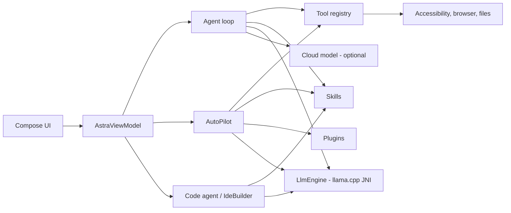
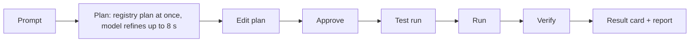

<div align="center">


# ZENIQ V14

**A local-first AI agent for Android: chat, automate, code, and connect your accounts.**


</div>

## What is ZENIQ

ZENIQ runs language models on your phone with llama.cpp (CPU) and can also use a cloud model when you add an OpenRouter key (Fast Mode). It does not just answer: it can operate your phone, browse, write files and talk to your accounts, and it reports the real result of every action.

## Features

| Area | What it does | Status |
|---|---|---|
| **Chat** | Streaming chat, tool calling, attachments, voice, `@auto` command, skills picker | Implemented |
| **Automate / AutoPilot** | Plan -> edit -> approve -> test run -> run -> verify; saved automation cards; daily schedule | Implemented, device-verify |
| **Skills (SkillForge)** | 62 built-in skills, auto-selection, custom and imported skills | Implemented |
| **Plugins** | Google Workspace, GitHub, Microsoft 365, Notion, Slack, Trello, Jira, Dropbox, Discord, Telegram, custom REST | Implemented, needs your credentials; not tested against live accounts |
| **Code** | Build apps and sites, IDE view, git (JGit), Claude Code mode | Implemented |
| **Models** | Download GGUF models, choose a model, Fast Mode with a cloud key | Implemented |
| **Files** | PDF, Word, Excel, PowerPoint, text; create DOCX/PPTX/XLSX/PDF/CSV | Implemented (large files: see Known limits) |
| **Voice** | Speech to text in the chat and IDE inputs | Implemented |
| **Terminal** | Embedded Linux terminal | Implemented, see `docs/EMBEDDED-TERMINAL.md` |

## Screenshots

| Dark | Light |
|---|---|
| `docs/media/chat-dark.png` | `docs/media/chat-light.png` |
| `docs/media/automate-dark.png` | `docs/media/automate-light.png` |

Capture them on the phone (power + volume down), copy the files into `docs/media/` with the names above and they will show here. Add GIFs the same way.

## Contents
[How it works](#how-it-works) · [Quick start](#quick-start) · [Usage](#usage) · [Project structure](#project-structure) · [CI and tests](#ci-and-tests) · [Troubleshooting](#troubleshooting) · [Known limits](#known-limits) · [Roadmap](#roadmap) · [License](#license)

## How it works





## Quick start

**Install:** download `ZENIQ.apk` from [Releases](../../releases) and install it (allow installs from this source).

| Permission | Why |
|---|---|
| Accessibility service | Lets ZENIQ read the screen and tap/type for phone automation. Off by default. |
| Notifications | Foreground service while a task runs, scheduled automations |
| Microphone | Voice input |
| Camera | Photo attachments and the camera tool |

**Build from source:** JDK 17, Android SDK 35, NDK `26.1.10909125`, CMake `3.22.1`, llama.cpp tag `b5618` (cloned by CI into `app/src/main/cpp/llama.cpp`).
```bash
chmod +x gradlew
./gradlew testDebugUnitTest assembleRelease
```

## Usage

<details><summary><b>Chat</b></summary>

Type normally. Type `@auto <task>` to turn a task into an automation card instead of asking the model. The **+** button adds files, photos, **Plugins** and **Skills**; picked skills show as chips and apply in Chat, Automate and Code.
</details>

<details><summary><b>Automate</b></summary>

AutoPilot: write a task and tap the arrow. A planning page shows real planner events, then an editable plan (agent names, instructions, skills, plugins, tools, order, dependencies). Approve runs a **test run** first (writes and sends are described, not done); then choose **Run for real**. Each prompt becomes a card you can run, test-run, edit, schedule (a notification appears at the time; tap it to run), duplicate or delete.
Phone steps need the Accessibility service; if it is off the run does not start and a button opens the settings.
</details>

<details><summary><b>Skills and Plugins</b></summary>

SkillForge lists built-in, custom and imported skills; imported text is stripped of instructions that try to override rules. Plugins use tokens (encrypted with the Android Keystore) or OAuth sign-in (you create your own Google/Microsoft client; see the card). Sending or deleting asks first (Plugins > Settings).
</details>

<details><summary><b>Code, Files, Terminal</b></summary>

See the Code tab, attach documents in chat, and `docs/EMBEDDED-TERMINAL.md`.
</details>

## Project structure

```
app/src/main/java/com/astra/agent/
  agent/   Agent loop, tool registry, loop guard, browser launch
  hub/     AutoPilot, skills, plugins, vault, OAuth
  llm/     llama.cpp engine, prompt formats, documents
  ui/      Compose screens and theme
  device/  accessibility, services
  code/    IDE builder, code agent, file storage
  docs/ site/  document and website generators
```

## CI and testing

GitHub Actions (`.github/workflows/build.yml`) installs the SDK/NDK, clones llama.cpp `b5618`, then runs `testDebugUnitTest`, `lintDebug`, `assembleDebug` and `assembleRelease`. The APK, test/lint reports and (on failure) the full build log are uploaded as artifacts. Unit tests cover the theme palette, loop guard, new-tab intent, skill selection, `@auto` parsing, plan save/restore and card migration.

## Troubleshooting

- **Phone steps do nothing:** turn on the ZENIQ accessibility service.
- **Slow answers:** local models run on the CPU; use a smaller quantized model or add a cloud key for Fast Mode.
- **Plugin shows "Not connected":** open Plugins, follow the setup text on its card.
- **Run stopped at the step limit:** send `continue`.

## Known limits

Not done yet, so not claimed: model roles and automatic routing, several resident models, native-template prompt rendering and per-family sampling, model self-test badges, streaming large-file indexing (files over 25 MB are still rejected), YouTube normal-vs-Shorts selection and the Download button flow. Not verified on a device: Chrome new-tab behavior, the AutoPilot device steps, scheduled notifications.

## Roadmap

The items under Known limits, plus the Phase 3 plugins (Zoom, Meet, Figma, Canva, Stripe, Shopify, Salesforce, HubSpot, Maps).

## Contributing

Open an issue or pull request. Keep CI green.

## License

ZENIQ bundles third-party components, some under GPL. **Read [THIRD_PARTY_NOTICES.md](THIRD_PARTY_NOTICES.md) before redistributing.**
